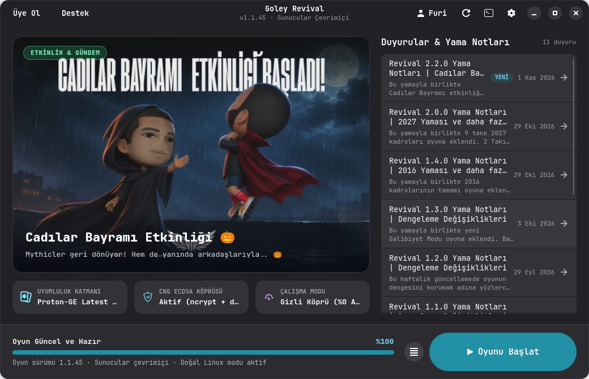

<div align="center">


# Goley Revival Linux — Kurulum Rehberi ve Başlatıcı ⚽🐧

**Goley Revival'ı Linux ve Steam Deck üzerinde oynamak isteyen oyuncular için geliştirilmiş açık kaynaklı doğal (native) başlatıcı.**

Windows CNG `ncrypt.dll` (`ECDSA_P256`) oturum köprüsü, DXVK Direct3D 9 optimizasyonu ve sıfır arka plan CPU kullanımı ile Goley Revival'ı Ubuntu, Debian, Arch Linux, CachyOS, Fedora, Linux Mint ve Steam Deck üzerinde sorunsuz, tek tıkla kurup oynamanızı sağlar.

[](Cargo.toml)
[](https://gnome.pages.gitlab.gnome.org/libadwaita/)
[](#kurulum-rehberi-t%C3%BCm-linux-da%C4%9F%C4%B1t%C4%B1mlar%C4%B1)
[](https://github.com/Fuwia/goley-revival-linux/releases)
[](LICENSE)

<br/><br/>



*GTK4 + Libadwaita ile canlı duyurular, tek tıkla CDN kurulumu, Proton-GE ve ncrypt oturum köprüsü entegrasyonu*

</div>

---

## 🎯 Neden `goley-revival-linux`?

Goley Revival'ı (`playrevival.co`) Linux üzerinde Wine veya Proton ile doğrudan çalıştırmaya çalıştığınızda üç temel sorunla karşılaşılır:

1. **Giriş Hatası (`Sunucuya ulaşılamadı. Lütfen tekrar deneyin` / `0x80090029`):**
   Hem 64-bit `revival_launcher.exe` hem de oyun içindeki 32-bit `revival_client.dll`, cihaz kimliğini imzalamak için Windows CNG `ncrypt.dll` kütüphanesinin **`ECDSA_P256`** kalıcı anahtar (`NCryptCreatePersistedKey` / `NCryptOpenKey` / `NCryptSignHash`) fonksiyonlarını çağırır. Mevcut Wine ve Proton sürümlerindeki yerleşik `ncrypt.dll` yalnızca RSA desteklediği veya anahtarı diske kaydetmediği için `NTE_NOT_SUPPORTED (0x80090029)` döndürür ve oyuna giriş yapılamaz.
2. **Bozuk Windows Başlatıcı Penceresi ve Yazı Tipleri:**
   Windows Qt6 başlatıcısı Wine/Wayland altında bozuk pencere kenarlıkları, kare şeklinde kırık emojiler (`□`) ve masaüstü ortamına uymayan bir görünümle açılır.
3. **Arka Planda Yüksek CPU Tüketimi (%60–%80):**
   Oyun açıkken arkada bekleyen Windows başlatıcısının QtQuick animasyon döngüsü boşta bile yüksek işlemci kullanmaya devam eder.

**`goley-revival-linux` tüm bu sorunları tek bir doğal Linux uygulamasında çözer:**
- Windows başlatıcı penceresini **hiç ekrana getirmeden** tüm etkinlik afişlerini, duyuruları, yama notlarını ve güncellemeleri doğrudan resmi sunuculardan doğal **GTK4 + Libadwaita** arayüzüne çeker.
- İçinde gömülü gelen açık kaynak **64-bit ve 32-bit `ncrypt.dll` (`ECDSA_P256`) köprüsünü** Wine/Proton önekine otomatik kurar.
- Oyun açıldığı anda arka plandaki resmi başlatıcıyı uyku moduna (`SW_HIDE`) alarak arka plan CPU kullanımını **%0**'a düşürür!

---

## ✨ Öne Çıkan Özellikler

- 🎨 **Doğal GNOME / Linux Görünümü:** *An Anime Game Launcher* ve *Faugus Launcher* gibi saf **GTK4 + Libadwaita** arayüzü. KDE Plasma, GNOME, Hyprland, Cinnamon, XFCE ve COSMIC ile tam uyumlu Koyu/Açık/Sistem teması.
- 👻 **Görünmez Arka Plan Köprüsü (Sıfır Windows Arayüzü):** Resmi `revival_launcher.exe` arka planda görünmez olarak oturum biletini (120 saniyelik tek kullanımlık ticket) üretir; anti-cheat ve sunucu doğrulaması %100 resmi akışla çalışır.
- 🔐 **Otomatik `ncrypt.dll` (`ECDSA_P256`) Yaması:** Hem `revival_launcher.exe` (x64) hem `BinaryTr/BinaryTrU.exe` (x86) için kalıcı `ECDSA_P256` anahtar sağlayıcısını otomatik kurar ve onarır.
- ⚡ **Windows `Setup.exe` Gerektirmeyen Hızlı CDN Kurulumu:** Oyunu sıfırdan resmi `patch.playrevival.co` CDN'i üzerinden **6 paralel bağlantı** ve **SHA-256 bütünlük doğrulamasıyla** indirir ve günceller.
- 🔄 **Mevcut Kurulumları Otomatik Tanıma:** Bilgisayarınızda daha önce Faugus Launcher (`~/Faugus/default`), Lutris veya `~/.wine` ile kurulmuş Goley Revival varsa tekrar indirmeden otomatik algılar.
- 🚀 **Oyun Araçları Entegrasyonu:** **UMU-Launcher (`umu-run`)**, **Proton-GE**, **Proton-CachyOS**, **Wine**, **Feral GameMode**, **MangoHud** ve **Gamescope** desteği + tek tıkla **NVIDIA PhysX** kurulumu.

---

## 🛠️ Nasıl Çalışır? (Mimari)

```text
┌──────────────────────────────────────────────────────────────────────┐
│        goley-revival-linux (Doğal Rust + GTK4 + Libadwaita)          │
│  • Etkinlik slaytları & Türkçe yama notları (api.playrevival.co)     │
│  • 6 iş parçacıklı SHA-256 doğrulamalı CDN güncelleyici              │
│  • Doğal hesap giriş penceresi, Runner & Prefix yöneticisi           │
└───────────────┬──────────────────────────────────────┬───────────────┘
                │ HTTPS (CDN & Duyurular)              │ GOLEY_HEADLESS=1
                ▼                                      ▼
┌───────────────────────────────┐      ┌───────────────────────────────┐
│  api.playrevival.co           │      │ Proton-GE / UMU / Wine Prefix │
│  patch.playrevival.co/objects │      │ • ncrypt.dll (x64 & x86 shim) │
│                               │      │ • Gizli revival_launcher.exe  │
└───────────────────────────────┘      │ • BinaryTrU.exe (Oyun Ekranı) │
                                       └───────────────────────────────┘
```

> **Güvenlik Notu:** `goley-revival-linux` oyun istemcisinin (`BinaryTrU.exe` veya `revival_client.dll`) belleğine müdahale etmez, paket şifrelemesini kırmaz veya hile korumalarını devre dışı bırakmaz. Yalnızca Wine/Proton'da eksik olan standart Windows `ncrypt.dll` (`ECDSA_P256` -> `bcrypt.dll`) kriptografi çağrılarını tamamlar.

---

## 📦 Kurulum Rehberi (Tüm Linux Dağıtımları)

Oyunun sorunsuz çalışması için sisteminizde önce bir **uyumluluk katmanı** (**Wine** veya **UMU-Launcher + Proton-GE**) kurulu olmalıdır. Aşağıdaki tablodan dağıtımınıza uygun hazır ikili paketi indirebilir veya tek komutla doğrudan kurabilirsiniz.

---

### 📥 Hazır Paket İndirmeleri (v0.1.7 Releases)

| Dağıtım / Platform | Paket Formatı | Kurulum Yöntemi | Doğrudan İndirme |
| :--- | :--- | :--- | :--- |
| 🚀 **Tüm Linux Dağıtımları & Steam Deck** | **AppImage** *(Taşınabilir Tek Dosya)* | `chmod +x *.AppImage && ./*.AppImage` | [İndir (.AppImage)](https://github.com/Fuwia/goley-revival-linux/releases/latest/download/goley-revival-linux-x86_64.AppImage) |
| 🐧 **Ubuntu / Debian / Linux Mint / Pop!_OS** | **.deb** | `sudo apt install ./goley-revival-linux_*.deb` | [İndir (.deb)](https://github.com/Fuwia/goley-revival-linux/releases/latest/download/goley-revival-linux_0.1.7_amd64.deb) |
| 🏹 **Arch Linux / CachyOS / Manjaro** | **.pkg.tar.zst** *(Pacman)* | `sudo pacman -U goley-revival-linux-*.pkg.tar.zst` | [İndir (.pkg.tar.zst)](https://github.com/Fuwia/goley-revival-linux/releases/latest/download/goley-revival-linux-0.1.7-1-x86_64.pkg.tar.zst) |
| 🎩 **Fedora / Nobara / openSUSE / RHEL** | **.rpm** | `sudo dnf install ./goley-revival-linux-*.rpm` | [İndir (.rpm)](https://github.com/Fuwia/goley-revival-linux/releases/latest/download/goley-revival-linux-0.1.7-1.x86_64.rpm) |
| 📦 **Taşınabilir Arşiv (Tüm Dağıtımlar)** | **.tar.gz** + `install.sh` | `tar -xzf *.tar.gz && ./install.sh` | [İndir (.tar.gz)](https://github.com/Fuwia/goley-revival-linux/releases/latest/download/goley-revival-linux-x86_64.tar.gz) |

---

### ⚡ Hızlı Tek Komut Kurulumu (Hazır Sürüm — Tüm Dağıtımlar)

Dağıtımınıza ait çalışma zamanı paketlerini (`gtk4`, `libadwaita`, `wine` veya `umu-launcher`) kurduktan sonra başlatıcıyı tek komutla kullanıcı dizininize (`~/.local/bin/goley-revival-linux` + uygulama menüsü kısayolu) kurabilirsiniz:

```bash
curl -fsSL https://raw.githubusercontent.com/Fuwia/goley-revival-linux/main/install.sh | bash
```

Uygulamayı başlatmak için uygulama menünüzden **Goley Revival** aratabilir veya uçbirimde şu komutu çalıştırabilirsiniz:

```bash
~/.local/bin/goley-revival-linux
```

*(Eğer `~/.local/bin` dizini `PATH` içinde değilse `~/.bashrc` veya `~/.zshrc` dosyanıza `export PATH="$HOME/.local/bin:$PATH"` satırını ekleyebilirsiniz.)*

---

### 1. Arch Linux / CachyOS / EndeavourOS / Manjaro / Garuda Linux

#### A) Gerekli Sistem ve Uyumluluk Paketlerini Kurun

```bash
sudo pacman -S --needed git base-devel gtk4 libadwaita wine gnutls lib32-gnutls winetricks gamemode lib32-gamemode mangohud lib32-mangohud
```

> **Önerilen (CachyOS / AUR kullanıcıları için):** En yüksek uyumluluk için `umu-launcher` ve `proton-ge-custom-bin` kurmanız tavsiye edilir:
> ```bash
> # CachyOS'ta doğrudan pacman ile, diğer Arch tabanlı dağıtımlarda yay/paru ile:
> yay -S --needed umu-launcher proton-ge-custom-bin
> ```

#### B) `PKGBUILD` (`makepkg`) ile Sistem Paketi Olarak Kurulum *(Önerilen)*

```bash
git clone https://github.com/Fuwia/goley-revival-linux.git
cd goley-revival-linux
sudo pacman -S --needed cargo mingw-w64-gcc pkgconf
makepkg -si -D packaging/arch
```
> Not: Yerel kaynak koddan doğrudan kurmak isterseniz ana dizinde `./install.sh --build` komutunu da çalıştırabilirsiniz.

---

### 2. Fedora Workstation / Nobara / Ultramarine Linux

#### A) Gerekli Sistem ve Geliştirme Paketlerini Kurun

```bash
sudo dnf install -y git curl gcc pkgconf-pkg-config \
  gtk4-devel libadwaita-devel \
  mingw64-gcc mingw32-gcc \
  wine winetricks gamemode mangohud
```

*(Nobara Linux kullanıyorsanız `umu-launcher` ve `Proton-GE` sistemde hazır gelir; standart Fedora'da ProtonUp-Qt ile `~/.local/share/Steam/compatibilitytools.d` içine GE-Proton indirebilirsiniz.)*

#### B) Derleme ve Kurulum

```bash
# Rust kurulu değilse rustup veya dnf ile kurun:
sudo dnf install -y rust cargo

git clone https://github.com/Fuwia/goley-revival-linux.git
cd goley-revival-linux
./install.sh --build
```

---

### 3. Debian / Ubuntu / Linux Mint / Pop!_OS / Zorin OS

*(Ubuntu 24.04 LTS+, Debian 13 Trixie+, Linux Mint 22+, Pop!_OS 24.04+ önerilir)*

#### A) 32-bit Mimariyi ve Paketleri Kurun

```bash
sudo dpkg --add-architecture i386
sudo apt update
sudo apt install -y git curl build-essential pkg-config \
  libgtk-4-dev libadwaita-1-dev \
  gcc-mingw-w64-x86-64 gcc-mingw-w64-i686 \
  wine wine32 wine64 winetricks gamemode mangohud
```

#### B) Rust Kurulumu ve Başlatıcıyı Derleme

Debian/Ubuntu depolarındaki Rust sürümü eski olabileceği için resmi `rustup` kullanılması önerilir:

```bash
curl --proto '=https' --tlsv1.2 -sSf https://sh.rustup.rs | sh -s -- -y
source "$HOME/.cargo/env"

git clone https://github.com/Fuwia/goley-revival-linux.git
cd goley-revival-linux
./install.sh --build
```

---

### 4. openSUSE Tumbleweed & Leap

```bash
sudo zypper install -y git curl gcc pkg-config cargo rust \
  gtk4-devel libadwaita-devel \
  cross-x86_64-w64-mingw32-gcc cross-i686-w64-mingw32-gcc \
  wine winetricks gamemode mangohud

git clone https://github.com/Fuwia/goley-revival-linux.git
cd goley-revival-linux
./install.sh --build
```

---

### 5. Void Linux

```bash
sudo xbps-install -Sy git curl base-devel pkg-config rust cargo \
  gtk4-devel libadwaita-devel \
  cross-x86_64-w64-mingw32 cross-i686-w64-mingw32 \
  wine wine-32bit winetricks gamemode MangoHud

git clone https://github.com/Fuwia/goley-revival-linux.git
cd goley-revival-linux
./install.sh --build
```

---

### 6. SteamOS / Steam Deck Kurulumu

Steam Deck'te dosya sistemi salt-okunur (immutable) olduğu için hiçbir sistem paketine dokunmadan **Masaüstü Modu (Desktop Mode)** üzerinden kurabilirsiniz:

1. Steam tuşuna basıp **Güç -> Masaüstüne Geç (Switch to Desktop)** seçeneğine tıklayın.
2. **Discover** mağazasından **ProtonUp-Qt** uygulamasını kurun ve en güncel **GE-Proton** sürümünü Steam içerisine indirin.
3. **Konsole** uygulamasını açıp hazır sürümü indirin:
   ```bash
   curl -fsSL https://raw.githubusercontent.com/Fuwia/goley-revival-linux/main/install.sh | bash
   ```
4. Masaüstü uygulama menüsünde **Goley Revival** üzerine sağ tıklayıp **"Add to Steam" (Steam'e Ekle)** seçeneğini seçin.
5. Artık **Gaming Mode**'a dönüp Goley Revival'ı doğrudan Steam kütüphanenizden başlatabilirsiniz! *(Steam içinde sağ tık -> Özellikler -> Uyumluluk kısmından herhangi bir Proton seçmenize **gerek yoktur**; çünkü uygulama doğal bir Linux yazılımıdır ve kendi içinde Proton'u yönetir.)*

---

## 🚀 İlk Kullanım Adımları

1. **Uygulamayı Açın:** Uygulama menüsünden **Goley Revival**'ı başlatın.
2. **Kurulum veya Otomatik Algılama:**
   - Eğer oyununuz daha önce Faugus Launcher veya Wine ile kuruluysa otomatik olarak algılanır ve **"Oyun Güncel ve Hazır"** yazar. *(Farklı bir klasördeyse sağ üstteki ⚙️ **Ayarlar -> Wine Prefix Dizini** kısmından seçebilirsiniz.)*
   - Eğer oyunu ilk kez kuruyorsanız sağ alttaki **"Oyunu İndir"** butonuna tıklayın; tüm dosyalar Windows kurulum sihirbazına gerek kalmadan doğrudan indirilecektir.
3. **Hesap Girişi ve Oynama:**
   - Sağ alttaki **"Oyunu Başlat"** butonuna tıklayın.
   - Açılan doğal GTK4 giriş penceresinde Goley Revival kullanıcı adınızı ve şifrenizi girin (**Beni Hatırla** seçeneği açıksa sonraki girişlerinizde şifre sormadan doğrudan oyunu açar).
4. **Oyun Açılışta `PhysXLoader.dll` / PhysX Hatası Verirse:**
   - Sağ üstteki ⚙️ **Ayarlar -> Bakım ve Onarım -> NVIDIA PhysX Runtime Kurulumu** satırındaki **"PhysX Kur"** butonuna tıklamanız yeterlidir.

---

## 🔧 Sıkça Sorulan Sorular ve Sorun Giderme (Goley Revival Linux)

<details open>
<summary><b>1. "Sunucuya ulaşılamadı (0x80090029)" ve Giriş Hatası Kesin Çözümü</b></summary>

Windows CNG `ncrypt.dll` kütüphanesinin `ECDSA_P256` işlevi Wine/Proton üzerinde varsayılan olarak desteklenmez ve Goley sunucusuyla el sıkışamaz (`NTE_NOT_SUPPORTED 0x80090029`).
`goley-revival-linux` bu hatayı kökten çözen açık kaynaklı x64 ve x86 `ncrypt.dll` shim köprülerini otomatik kurar. Eğer bu hatayı almaya devam ederseniz:
- Sağ üstteki ⚙️ **Ayarlar -> Bakım ve Onarım** sekmesine gidin.
- **"Linux Uyumluluk Köprüleri -> Yeniden Kur"** butonuna tıklayın.
- Bu işlem hem 64-bit hem 32-bit `ncrypt.dll` köprülerini yeniler ve Wine önekinize `WINEDLLOVERRIDES="ncrypt=n,b"` kuralını uygular.
</details>

<details open>
<summary><b>2. "Oyun başlıyor. Lütfen bekleyiniz." Splash Ekranında Kalma veya Çökme Çözümü (DXVK & D3D9)</b></summary>

Goley Revival'ın `BinaryTrU.exe` istemcisi `D3D9`, `D3DX9_42` ve `D3DCompiler_42` DirectX kütüphanelerini çağırarak shader derlemesi yapar. Wine'ın yerleşik `wined3d` motoru bu shaderları (`Shader.VLD`) derleyemez ve `BugTrap.dll` çökmesine veya splash ekranında donmaya yol açar.
- **v0.1.4 ile Çözüldü:** Başlatıcımız artık DXVK Direct3D 9 ve yerel DLL geçersiz kılmalarını (`ncrypt=n,b;d3d9,d3dx9_42,d3dx9_31,d3dcompiler_42,d3d10core,d3d11,dxgi=n,b`) otomatik devreye sokar.
- Eğer oyununuz yine de açılmazsa sağ üstteki ⚙️ **Ayarlar -> Bakım ve Onarım -> NVIDIA PhysX Runtime Kurulumu** butonuna tıklayarak eksik PhysX motorunu yükleyin.
</details>

<details>
<summary><b>3. Steam Deck ve SteamOS Gaming Mode Kurulumu</b></summary>

Steam Deck'in salt-okunur dosya sistemini bozmadan tek tıkla çalıştırabilirsiniz:
- Masaüstü Modu'nda (Desktop Mode) yukarıdaki tablodan **AppImage** dosyasını indirin.
- İndirdiğiniz `.AppImage` dosyasına sağ tıklayıp *Özellikler -> İzinler -> Çalıştırılabilir* yapın ve **"Add to Steam" (Steam'e Ekle)** deyin.
- Gaming Mode'a döndüğünüzde Goley Revival'ı doğrudan konsol arayüzünden başlatabilirsiniz. Başlatıcı arka planda Proton-GE ve UMU-Run ile tam entegre çalışır.
</details>

<details>
<summary><b>4. Maç İçinde Ok Tuşlarının Çalışmaması</b></summary>

Varsayılan klavye düzeninde **hareket ok tuşlarıyla**, pas/şut gibi eylemler ise **W-A-S-D** ile yapılır. WASD veya Esc'nin çalışması, yön tuşlarının da doğru okunduğunu göstermez. Linux/Wine üzerinde maç içinde oklarla hareket edilemiyorsa nedenini ayırt etmek için giriş tanısı gerekir; bu sorun için doğrulanmış bir otomatik düzeltme henüz yoktur.

Geliştirici tanısı: [klavye test aracı](tools/README.md), oyunun dosyalarını ve tuş atamalarını değiştirmeden Win32/DirectInput durumlarını karşılaştırır. Eski `dinput8.dll` köprüsü kilitlenme sorunları nedeniyle kaldırılmıştır.
</details>

<details>
<summary><b>5. "Çalıştırıcı bulunamadı (Wine/UMU kurun)" Uyarısı</b></summary>

Sisteminizde `umu-run` veya `wine` kurulu olduğundan emin olun:
- **Arch / CachyOS:** `yay -S umu-launcher proton-ge-custom-bin wine`
- **Ubuntu / Debian:** `sudo apt install wine wine64 wine32`
- **Fedora:** `sudo dnf install wine`
En akıcı deneyim için **ProtonUp-Qt** ile bir **GE-Proton** sürümü indirmeniz önerilir.
</details>

<details>
<summary><b>6. Canlı Hata Günlükleri (Loglar) ve Hata Ayıklama</b></summary>

Üst çubuktaki **Terminal (`>_`)** simgesine tıklayarak **Canlı Günlükler (Logs)** penceresini açabilir veya **Ayarlar -> Geliştirici / Hata Ayıklama** altından *"Arka Plan Windows Başlatıcısını Göster"* seçeneğini açıp arka plandaki tüm işlemleri izleyebilirsiniz.

Günlük penceresi açıkken kayıtlar yenilenir. **Günlükleri Panoya Kopyala** düğmesi oturum kayıtlarını, resmi başlatıcının `launcher.log` dosyasını ve Wine/Proton çıktısının tutulduğu `runner.log` dosyasını bir araya getirir. Oturum kayıtlarında uygulama sürümü, mimari, masaüstü/oturum türü ve kullanılan uyumluluk katmanı da bulunur. Önceden açık olan bir başlatıcı kullanılıyorsa bu ayrıca belirtilir.

**"Sunucudan giriş bileti alınıyor..." ekranında kalıyorsa:** Bu yazı bilet isteğinin gönderildiğini belirtir; biletin alındığını doğrulamaz. Takılma sırasında günlükleri kopyalayın ve hata bildiriminize ekleyin. Başlatıcı oyun açılmadan kapanırsa veya başlatma 150 saniyeyi aşarsa uygulama son beklenen aşamayı hata mesajında bildirir.
</details>

<details>
<summary><b>7. Uygulamayı Kaldırma</b></summary>

```bash
curl -fsSL https://raw.githubusercontent.com/Fuwia/goley-revival-linux/main/uninstall.sh | bash
```
</details>

---

## 🤝 Katkıda Bulunma ve Lisans

Bu proje topluluk tarafından Linux oyuncularının Goley Revival'ı özgür ve akıcı şekilde oynayabilmesi için geliştirilmiştir; resmi Goley Revival yönetimi ile doğrudan bir bağı yoktur.

- **ncrypt Köprüsü Kaynak Kodu:** [`ncrypt-shim/ncrypt_shim.c`](ncrypt-shim/ncrypt_shim.c)
- **GTK4 + Libadwaita Arayüzü:** [`src/`](src/)
- **Lisans:** [GNU General Public License v3.0 (GPL-3.0)](LICENSE)
